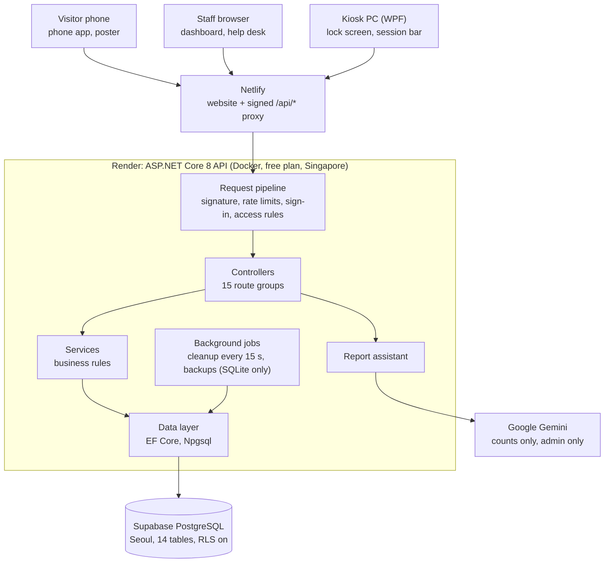
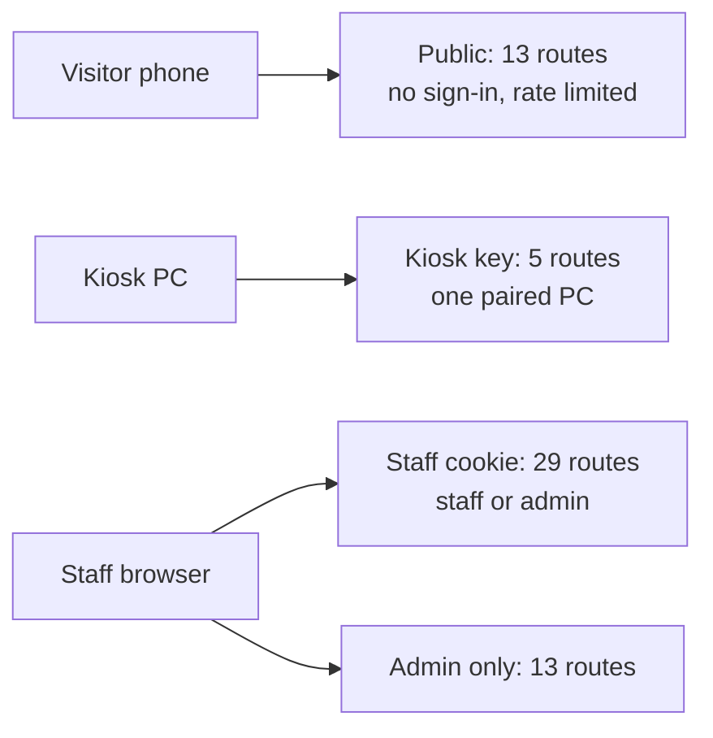

# MISA architecture

Where each part runs, how a request travels, and which API routes who may call. Written
15 Nov 2026 from the code and config (controllers, `Program.cs`, `Auth/*`, `netlify.toml`,
`render.yaml`), not from a running system. If a route changes, update the tables below.

## Runtime layers (cloud test deployment)

- The browser and kiosks only ever talk to Netlify. Netlify forwards `/api/*` to Render and
  signs each request (`API_SIGNATURE_TOKEN`); the API refuses unsigned ones (403), except `/health`.
- The visitor's address comes from Netlify's `x-nf-client-connection-ip` header, trusted only on signed requests.
- Rate limits count per device (`misa.device` cookie), with a shared cap per network address.
- Staff sign in with a cookie (`misa.staff`, 10 hours, sliding). Kiosks use their own key from a one-time pairing code.
- The same code can run on one PC at the DTC (DEPLOYMENT.md, option A): the API serves the
  built website itself and uses a SQLite file, with no Netlify, Render or Supabase.
- Supabase's Data API is off and row-level security is on for every table (no policies);
  the API signs in as the table owner, which skips RLS.

## Who may call what

A route with no attribute falls back to the staff policy (`FallbackPolicy` in `Auth/AuthSetup.cs`),
so only routes marked `[AllowAnonymous]`, kiosk or admin are different.
Staff sign-in (`/api/auth/login`) and kiosk pairing (`/api/kiosk/pair`) are public by necessity
and rate limited; the kiosk also calls the public pairing route once.

## API routes (60)

### Public (13)

| Route | Notes |
|---|---|
| `GET /health` | `{"status":"ok"}`; the only route that skips the Netlify signature check |
| `GET /api/public/computers` | PC names and status for the phone app |
| `POST /api/auth/login` | sign-in limit |
| `POST /api/auth/logout` | |
| `POST /api/kiosk/pair` | pairing limit; exchanges a one-time code for the PC's key |
| `POST /api/visits` | register a visit; registrations limit |
| `GET /api/visits/{token}` | the visitor's own visit, by token |
| `POST /api/visits/{token}/pass` | get a pass; passes limit |
| `POST /api/visits/{token}/pass/cancel` | |
| `POST /api/visits/{token}/session/end` | |
| `POST /api/visits/{token}/session/extend` | |
| `POST /api/visits/{token}/waitlist` | join the waitlist; waitlist limit |
| `DELETE /api/visits/{token}/waitlist` | leave the waitlist |

### Kiosk key (5)

`POST /api/kiosk/heartbeat`, `/sessions`, `/session/end`, `/session/extend`, `/help`.
A kiosk can only see and act on its own PC.

### Staff cookie (29, staff or admin)

| Area | Routes |
|---|---|
| Account | `GET /api/auth/me`, `POST /api/auth/password` |
| Help desk board | `GET /api/board` |
| PCs | `GET /api/computers`, `GET /api/computers/{id}`, `GET /api/computers/{id}/sessions` |
| Visits | `GET /api/visits`, `POST /api/visits/walk-in` |
| Passes | `GET /api/passes`, `POST /api/passes/lookup`, `POST /api/passes/check-in` |
| Sessions | `GET /api/sessions/active`, `GET /api/sessions`, `GET /api/sessions/{id}`, `POST /api/sessions/{id}/end`, `POST /api/sessions/{id}/extend` |
| Waitlist | `GET /api/waitlist` |
| Problems | `GET /api/problems`, `POST /api/problems`, `PUT /api/problems/{id}/resolve` |
| Peripherals | `GET /api/peripherals`, `POST /api/peripherals`, `PUT /api/peripherals/{id}/assign`, `PUT /api/peripherals/{id}/use` |
| Help requests | `GET /api/assist`, `POST /api/assist`, `PUT /api/assist/{id}/status` |
| Reports | `GET /api/reports/summary`, `GET /api/reports/export` (lists with visitors' names are admin-only: 403 otherwise) |

### Admin only (13)

| Area | Routes |
|---|---|
| PCs | `POST /api/computers`, `PUT /api/computers/{id}`, `DELETE /api/computers/{id}`, `POST /api/computers/{id}/pairing-code`, `POST /api/computers/{id}/unpair` |
| Audit log | `GET /api/audit` |
| Staff accounts | `GET /api/staff`, `POST /api/staff`, `PUT /api/staff/{id}`, `POST /api/staff/{id}/password`, `POST /api/staff/{id}/unlock` |
| Gemini report assistant | `GET /api/reports/assistant`, `POST /api/reports/assistant` (20 s timeout when hosted) |

Swagger is enabled in development only.

## Data (14 tables)

`Computers`, `Peripherals`, `Sessions`, `AssistTickets`, `Visits`, `VisitSectors`,
`VisitServices`, `Passes`, `ProblemReports`, `WaitlistEntries`, `Staff`, `AuditLog`,
`DataProtectionKeys` (staff sign-in keys, so a restart doesn't sign staff out), and
`__EFMigrationsHistory`. Visit records are deleted after 1 year (`KeepVisitsDays`).
Two migration sets exist: `Migrations/` (SQLite) and `Migrations/Postgres/`.

## Where the code lives

| Folder | What |
|---|---|
| `TrackerApi/TrackerApi` | the API: `Controllers/`, `Services/`, `Auth/` (sign-in, hosting, rate limits), `Data/`, `Models/` |
| `TrackerApi/TrackerApi.Tests` | API tests (in memory, fake clock) |
| `tracker-web/tracker-web` | React + Vite: `src/dashboard/` (staff), `src/visitor/` (phone), `src/api.js`, `src/polling.js` |
| `KioskApp` | WPF kiosk app; `Core/ApiClient.cs` makes the calls above; `setup/Setup-KioskPC.ps1` locks the PC down |
| `KioskApp.Tests` | tests for the kiosk's logic |
| `render.yaml`, `TrackerApi/TrackerApi/Dockerfile` | Render service |
| `tracker-web/tracker-web/netlify.toml` | Netlify build, `/api/*` proxy, security headers |
